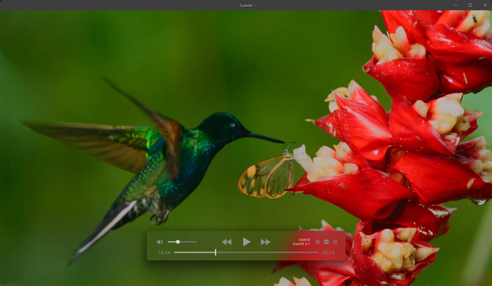
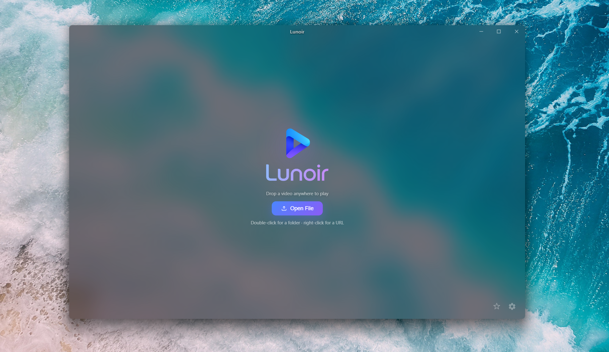
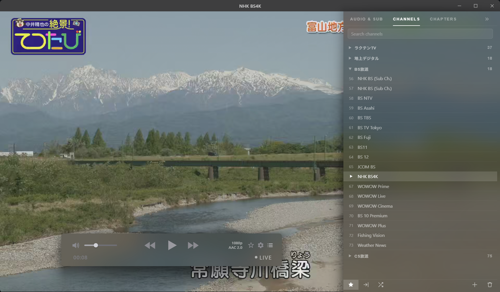
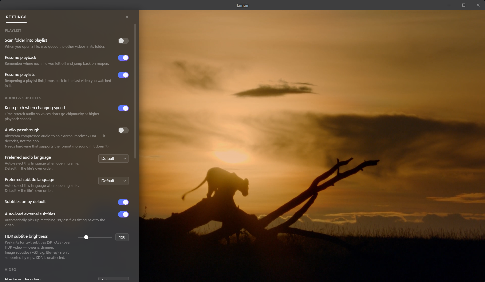
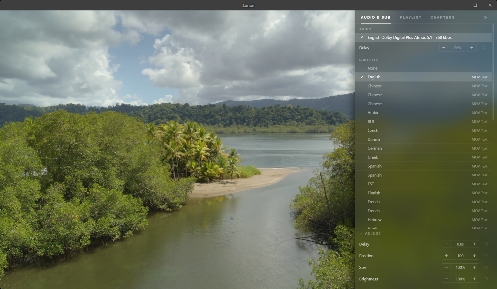

<p align="right">
  <strong>🇹🇷 Türkçe</strong> | <a href="README.md">🇬🇧 English</a>
</p>

<p align="center">
  
</p>


### Windows için şık bir medya oynatıcı — **mpv** altyapısıyla, **IINA** tarzında.

Çerçevesiz ve buzlu cam görünümlü arayüzüyle neredeyse her şeyi oynatır; kare hassasiyetine ve renk doğruluğuna önem verenler için tasarlanmıştır. Temiz, Windows 11 akrilik arayüzünün altında [mpv](https://mpv.io/) çekirdeğini kullanan Electron + React uygulamasıdır.


[](https://github.com/zhbj420/Lunoir/releases/latest)

## ⬇️ İndir

**[→ En son sürümü indir](https://github.com/zhbj420/Lunoir/releases/latest)** — `Lunoir-<version>-setup.exe` kurulum dosyasını veya kurulum gerektirmeyen `-portable.exe` sürümünü indirin. Windows 10 / 11.

> Uygulama imzalanmamıştır; bu nedenle Windows SmartScreen ilk çalıştırmada uyarı gösterebilir. **Daha fazla bilgi → Yine de çalıştır** seçeneğine tıklayın.

> Lunoir, [IINA](https://iina.io/) veya [mpv](https://mpv.io/) ile bağlantısı ya da bu projeler tarafından onaylanmışlığı bulunmayan **bağımsız** bir projedir. Arayüz tasarımı IINA'dan *esinlenmiştir*; IINA'nın kodları kullanılmamıştır. Proje erken aşamadadır ve aktif olarak geliştirilmektedir; bu nedenle bazı pürüzlerle karşılaşabilirsiniz.

## Ekran görüntüleri

<p align="center">
  
</p>

| Ana ekran | Canlı TV / IPTV |
| :---: | :---: |
|  |  |
| **Ayarlar** | **Ses ve altyazı parçaları** |
|  |  |

## Neden Lunoir?

VLC her yerde bulunur ancak tasarımı eskimiştir; PotPlayer güçlüdür ancak kapalı kaynaklıdır ve ek yazılımlar içerir; MPC-HC hafiftir ama 2009'dan kalmış gibi görünür. [**mpv**](https://mpv.io/) mevcut en iyi oynatma motorlarından biridir ancak gerçek bir grafik arayüzü sunmaz. Lunoir bu boşluğu doldurur: **mpv'nin görüntü işleme kalitesini gerçekten şık bir Windows arayüzüyle birleştirir** — özünde *Windows için IINA*. Açık kaynaklıdır (MIT); telemetri, reklam ve ek yazılım paketi içermez.

## Özellikler

**Oynatma (mpv çekirdeği)**
- mpv/FFmpeg'in desteklediği hemen hemen her şeyi oynatır: MKV, MP4, MOV, TS, M2TS, WebM…
- `gpu-next` görüntü işleme: Dolby Vision, HDR10 / HDR10+ ton eşleme, 10 bit
- Blu-ray / DVD disk **klasörlerini** (`bd://` / `dvd://`) açar ve ana başlığı oynatır
- yt-dlp aracılığıyla çevrimiçi video ve **oynatma listeleri** (YouTube vb.)
- **Canlı TV / IPTV** — yerel bir `.m3u` / `.txt` kanal listesini veya URL'yi yükleyin. Kanallar, `group-title` değerlerine göre daraltılabilir ve aranabilir bölümlerde gruplanır. Canlı yayınlarda `● LIVE` rozeti ve tek dokunuşla “canlıya geç” seçeneği bulunur; yayınlar yeniden kodlanmadan (akış kopyalama yöntemiyle) MKV olarak **kaydedilebilir**.
- **Düşük kaliteli kaynaklar için görüntü iyileştirme** *(isteğe bağlıdır, varsayılan olarak kapalıdır)* — canlı TV ve IPTV'de sık görülen sıkıştırma bozulmalarını azaltmak için blok giderme ve parazit azaltma, keskinleştirme filtresi ve isteğe bağlı yapay sinir ağı tabanlı parlaklık ayrıntısı (ArtCNN) ve renk (CfL) yeniden oluşturma. **Kaliteli bir görüntü izliyorsanız kapalı bırakın** — temiz ve yüksek kaliteli kaynaklarda bu işlemler gerçek ayrıntıları yumuşatabilir.

**Arayüz**
- Video üzerinde buzlu cam efekti oluşturan, IINA tarzı kayan OSC denetimleri (gerçek Windows 11 akrilik pencere efekti)
- Oynatma listesi / bölümler / ses ve altyazı parçaları ile ayarlar için akrilik yan paneller
- **Yönetilebilir oynatma listesi** — sürükleyerek sıralama, çoklu seçim (Ctrl / Shift), oynatmak için çift tıklama ve toplu silme
- **Kaydedilenler ve son kullanılanlar için buzlu cam başlatıcısı** — yakın zamanda oynatılan yerel dosyalar ve URL'ler ile kaydedilmiş dosyalar, URL'ler, oynatma listeleri ve IPTV kaynakları. Her öğe yeniden adlandırılabilir veya silinebilir. Geçerli kuyruğu oynatma listesi, geçerli kanal listesini de doğrudan panelden kaynak olarak kaydedebilirsiniz.
- **10 arayüz dili** — İngilizce, Türkçe, 简体中文, Français, Deutsch, Español, Português, Русский, 日本語, 한국어 (Windows dilinizi otomatik algılar)
- Çerçevesiz pencere, sürükle-bırak desteği ve Dosya Gezgini'nden doğrudan dosya açma (dosya ilişkilendirmeleri)
- Sağ tıklama menüsü; pencere boyutunu ve ses düzeyini hatırlar

**Kare hassasiyeti gerektiren işler için**
- Zaman / **zaman kodu** (SMPTE `HH:MM:SS:FF`) / **kare numarası** göstergesi — görünüm biçimleri arasında geçiş yapmak için tıklayın
- Gerçek tek kare ilerletme ve ekran görüntülerine de yansıyan, köşede sürekli gösterilebilen **görüntü üzerine işlenmiş** zaman/kare bilgisi
- MediaInfo aracılığıyla ayrıntılı parça bilgileri — ticari ses biçimi adları (Dolby TrueHD / Atmos, DTS-HD) ve HDR türü rozeti (DV / HDR10 / HDR10+)

**Ek kolaylıklar**
- Ekran görüntüleri (PNG / JPG; altyazılı veya altyazısız, özel klasöre kaydetme, başlık ve konuma göre dosya adı)
- **Altyazı biçimlendirme** — yazı tipi, boyut, karakter aralığı, dış çizgi ve konum; ayrıca her video için gecikme / konum / boyut / parlaklık ayarları
- A-B döngüsü, ses perdesini koruyan oynatma hızı, karıştırma / yineleme ve harici altyazıları otomatik yükleme
- Ses geçişi (bit akışını harici alıcıya gönderme) ve OSC denetimlerinin otomatik gizlenme süresini ayarlama
- Dosya ve oynatma listesi bazında oynatmaya kaldığı yerden devam etme

**Deneysel** *(isteğe bağlıdır; Ayarlar › Deneysel bölümünde)* 
- **Zaman çizelgesi** — bir klasördeki klipleri tek bir kesintisiz videoda birleştirin, her klibin giriş/çıkış noktalarını kırpın ve herhangi bir klibe kendine özgü bir **oynatma kare hızı** atayın (klibe sağ tıklayın). Böylece yüksek kare hızlı görüntüler gerçek ağır çekim olarak oynatılabilir. mpv'nin yerel EDL özelliğini kullanır.
- **Başka bir yerde düzenleme yaparken hızlı önizleme ve kabaca referans alma** amacıyla tasarlanmıştır; bir video düzenleme aracı değildir ve bu işlevi sunmaya çalışmaz. Özellik erken aşamadadır; bazı pürüzler olabilir.

## Gereksinimler

- Windows 10 / 11 (akrilik efektler Windows 11'de en iyi görünür)
- [Node.js](https://nodejs.org/) 18 veya üzeri (kaynak koddan derlemek için)

## Başlarken

```bash
npm install      # bağımlılıkları yükle
npm run setup    # mpv ve MediaInfo'yu resources/ klasörüne indir
npm run dev      # geliştirme modunda başlat
```

## Kurulum dosyası oluşturma

```bash
npm run dist     # dist/ klasöründe Windows kurulum dosyası oluştur
```

## Klavye kısayolları

| Tuş | İşlev |
| --- | --- |
| Space / K | Oynat / Duraklat |
| ← / → | ±5 saniye ileri / geri sar |
| ← / → | (Duraklatıldığında) kare ilerlet |
| ↑ / ↓ | Ses düzeyini ±5 artır / azalt |
| F | Tam ekran |
| M | Sesi kapat |
| Ctrl+O | Dosya aç |

Diğer işlemlere **sağ tıklama menüsünden** ve **ayarlar panelinden** ulaşabilirsiniz.

## Nasıl çalışır?

mpv, `--wid` aracılığıyla videoyu ana pencereye işler ve JSON tabanlı IPC adlı bir adlandırılmış kanal üzerinden kontrol edilir. Buzlu cam denetimleri (OSC) ve yan paneller, videonun üzerine yerleştirilmiş **ayrı Windows 11 akrilik alt pencereleridir**. Sistem düzeyindeki buzlu cam efektinin alttaki mpv görüntüsünü örnekleyebilmesini sağlayan yöntem budur. React görüntüleyicisi pencere türünden bağımsızdır; Electron ana süreci mpv'yi, pencereleri ve bunların yerleşim/animasyonlarını yönetir.

## Katkıda bulunan projeler

Uygulama [mpv](https://mpv.io/), [FFmpeg](https://ffmpeg.org/), [yt-dlp](https://github.com/yt-dlp/yt-dlp) ve [MediaInfo](https://mediaarea.net/en/MediaInfo) ile çalışır; arayüz tasarımı [IINA](https://iina.io/) projesinden esinlenmiştir. Lisanslar için [CREDITS.md](CREDITS.md) dosyasına bakın.

## Teşekkürler

[@zhbj420](https://github.com/zhbj420) tarafından [Claude](https://www.anthropic.com/claude) (Anthropic) ile birlikte, ilk prototipten bu sürüme kadar eşli programlama yaklaşımıyla geliştirilmiştir.

## Lisans

[MIT](LICENSE) © 2026 Yao666
